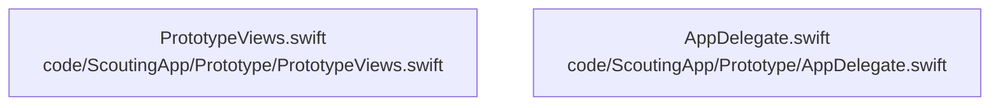

# dependency-map

[解析トップへ戻る](../README.md)

内容確認したソースの静的依存関係。PythonはAST、JavaScript／TypeScriptはimport文の字句抽出です。型だけのimport、再export、コメントや動的importの扱いには制限があり、ランタイム依存の完全なグラフではありません。

## 要素の説明

### n-code-scoutingapp-prototype-appdelegate-swift-5d77c3

確認済みファイル: `code/ScoutingApp/Prototype/AppDelegate.swift`

解析: 字句抽出。静的なimport／export参照です。関数の実行順序やHTTP通信は表していません。

宣言: `AppDelegate`

- `UIKit` → 外部・標準ライブラリ・別名など。ローカル対応先は未確定

[詳細な図と説明を見る](n-code-scoutingapp-prototype-appdelegate-swift-5d77c3/README.md)

### n-code-scoutingapp-prototype-prototypeviews-swift-867470

確認済みファイル: `code/ScoutingApp/Prototype/PrototypeViews.swift`

解析: 字句抽出。静的なimport／export参照です。関数の実行順序やHTTP通信は表していません。

宣言: `AppColors`, `AppTextStyles`, `PrimaryButtonStyle`, `SecondaryButtonStyle`, `SplashView`, `OnboardingView`, `OnboardingPage`, `LoginSelectionView`, `RegistrationView`, `LoginView`, `ProfileSetupView`, `HomeView`, `HomeTabView`, `MatchCard`, `SmallMatchCard`, `StatItem`, `FeedbackCard`, `ScheduleTabView`, `ScheduleMatchCard`, `ReportTabView`, `ReportCard`, `ProfileTabView`, `ContentView_Previews`

- `SwiftUI` → 外部・標準ライブラリ・別名など。ローカル対応先は未確定

[詳細な図と説明を見る](n-code-scoutingapp-prototype-prototypeviews-swift-867470/README.md)

