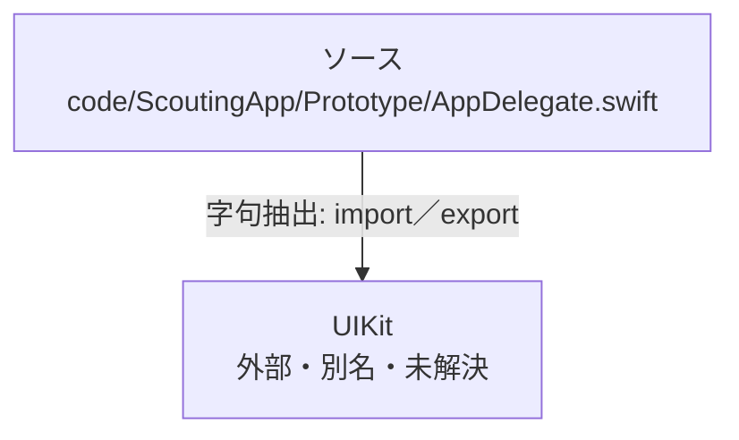

# dependency-map/n-code-scoutingapp-prototype-appdelegate-swift-5d77c3

[解析トップへ戻る](../../README.md)

確認済みファイル: `code/ScoutingApp/Prototype/AppDelegate.swift`

解析: 字句抽出。静的なimport／export参照です。関数の実行順序やHTTP通信は表していません。

宣言: `AppDelegate`

- `UIKit` → 外部・標準ライブラリ・別名など。ローカル対応先は未確定

## 要素の説明

### n-uikit-b4b5ba

参照名: `UIKit`

ローカルのソース対応先を確定できませんでした。外部ライブラリ、標準ライブラリ、型別名などを区別する追加確認が必要です。

### source

`code/ScoutingApp/Prototype/AppDelegate.swift` の内容を確認しました。

