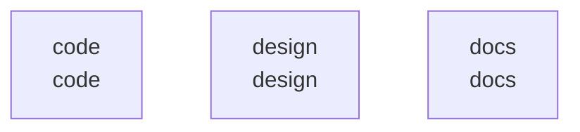

# overall-architecture

[解析トップへ戻る](../README.md)

# ScoutingApp

FanScoutのiOS試作。SwiftUIの画面とUIKitのアプリ起動コードを確認しました。

この図はリポジトリ内の構成です。コードを実行した結果やサービス間の通信保証ではありません。

## 対象と根拠

対象: https://github.com/FORIFOR/ScoutingApp

取得ブランチ: `main`

Git tree SHA: `30a35d7be7b7e433f790f0af559cf3b9c172e43b`

ファイル一覧: 39件。内容確認: 3件。全ファイルの意味解析ではありません。

## 解析の制約

実コードの取得は入口、マニフェスト、直接参照先を中心とする初回解析です。動的ロード、実行時設定、別リポジトリとの接続、ローカル未コミット変更は未確認です。

## 確認が必要な点

構成図の配置関係と、実際の通信・呼び出し関係を区別してください。README上の機能や精度の記述は動作検証済みという意味ではありません。

## 追加解析

未読の中核モジュールから処理順序・データ保存・状態遷移を追加解析する。実行環境で通信先と機能フラグを照合する。

## 補足

2026-10-11の初回解析スナップショットです。現在のコードとの差分や実行環境は追加確認が必要です。

## 要素の説明

### n-code-e6fb06

確認したパス: `code`。配下の登録ファイルは20件。

- `code/ScoutingApp/Core/Authentication/AuthenticationService.swift`（一覧のみ）
- `code/ScoutingApp/Core/Database/FirebaseManager.swift`（一覧のみ）
- `code/ScoutingApp/Core/Database/SyncManager.swift`（一覧のみ）
- `code/ScoutingApp/Core/Models/Models.swift`（一覧のみ）
- `code/ScoutingApp/Core/Report/AnalyticsService.swift`（一覧のみ）
- `code/ScoutingApp/Core/Report/ReportService.swift`（一覧のみ）
- `code/ScoutingApp/Core/Report/RewardService.swift`（一覧のみ）
- `code/ScoutingApp/Core/Schedule/ScheduleService.swift`（一覧のみ）
- `code/ScoutingApp/Core/Security/SecurityManager.swift`（一覧のみ）
- `code/ScoutingApp/Prototype/AppDelegate.swift`（内容確認済み）
- `code/ScoutingApp/Prototype/PrototypeViews.swift`（内容確認済み）
- `code/ScoutingApp/Prototype/SceneDelegate.swift`（一覧のみ）
- `code/ScoutingApp/Tests/AuthenticationTests.swift`（一覧のみ）
- `code/ScoutingApp/Tests/IntegrationTests.swift`（一覧のみ）
- `code/ScoutingApp/Tests/PerformanceTests.swift`（一覧のみ）
- `code/ScoutingApp/Tests/ReportServiceTests.swift`（一覧のみ）
- `code/ScoutingApp/Tests/SecurityTests.swift`（一覧のみ）
- `code/ScoutingApp/Tests/SyncManagerTests.swift`（一覧のみ）
- `code/ScoutingApp/Tests/UITests.swift`（一覧のみ）
- `code/ScoutingApp/Tests/UsabilityTests.swift`（一覧のみ）

### n-design-056f11

確認したパス: `design`。配下の登録ファイルは3件。

- `design/design_guidelines.md`（一覧のみ）
- `design/mockups/mockup_description.md`（一覧のみ）
- `design/wireframes.md`（一覧のみ）

### n-docs-71ab8b

確認したパス: `docs`。配下の登録ファイルは14件。

- `docs/api_documentation.md`（一覧のみ）
- `docs/architecture.md`（一覧のみ）
- `docs/delivery_plan.md`（一覧のみ）
- `docs/demo_video_script.md`（一覧のみ）
- `docs/feedback_plan.md`（一覧のみ）
- `docs/presentation.md`（一覧のみ）
- `docs/refactoring_plan.md`（一覧のみ）
- `docs/release_plan.md`（一覧のみ）
- `docs/requirements.md`（一覧のみ）
- `docs/technical_documentation.md`（一覧のみ）
- `docs/testing_qa_plan.md`（一覧のみ）
- `docs/todo.md`（一覧のみ）
- `docs/user_flow.md`（一覧のみ）
- `docs/user_manual.md`（一覧のみ）

